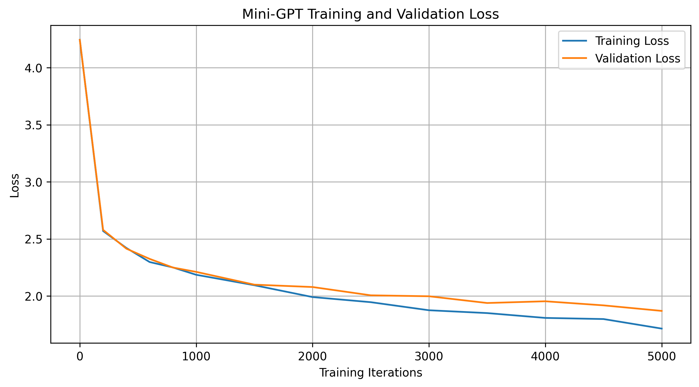

# Mini-gpt-from-scratch
A beginner-friendly GPT-style language model built from scratch using PyTorch and trained on the Tiny Shakespeare dataset. Implements token embeddings, positional embeddings, causal self-attention, multi-head attention, Transformer blocks, and text generation

# Mini-GPT: Character-Level Language Model from Scratch

This project implements and trains a small GPT-style character-level language model from scratch using **PyTorch** and the **Tiny Shakespeare** dataset.

The model uses a decoder-only Transformer architecture with token embeddings, positional embeddings, causal self-attention, multi-head attention, feed-forward networks, layer normalization, and residual connections.

The objective was to understand the fundamental concepts behind GPT-style language models by building, training, and testing one from random initialization.

## Project Overview

- **Dataset:** Tiny Shakespeare
- **Vocabulary size:** 65 unique characters
- **Task:** Autoregressive next-character prediction
- **Framework:** PyTorch
- **Environment:** Google Colab
- **Training:** 5,000 iterations

## Architecture

The model was implemented using the following components:

1. **Head:** Implements causal self-attention using query, key, and value projections with a lower-triangular mask.
2. **MultiHeadAttention:** Combines four attention heads operating in parallel.
3. **FeedForward:** Uses linear layers, GELU activation, and dropout.
4. **TransformerBlock:** Combines attention and feed-forward layers with layer normalization and residual connections.
5. **GPTLanguageModel:** Combines token and positional embeddings, two Transformer blocks, final layer normalization, and a language-model output head.

## Model Specifications

| Parameter | Value |
|---|---:|
| Vocabulary size | 65 |
| Embedding dimension | 128 |
| Transformer blocks | 2 |
| Attention heads | 4 |
| Context length | 32 |
| Batch size | 16 |
| Dropout | 0.1 |
| Total parameters | 204,929 |
| Optimizer | AdamW |
| Learning rate | 0.0003 |
| Loss function | Cross-Entropy |
| Training iterations | 5,000 |

## Dataset and Preprocessing

The model was trained on the Tiny Shakespeare dataset.

Dataset source: https://github.com/karpathy/char-rnn/blob/master/data/tinyshakespeare/input.txt

Preprocessing included:
- Character-level tokenization.
- Mapping unique characters to integer token IDs.
- Splitting the dataset into 90% training and 10% validation data.
- Creating input and target sequences for next-character prediction.

## Training Results

The model was trained for 5,000 iterations using the AdamW optimizer.

Training and validation loss decreased during training, showing that the model learned character-level patterns from the dataset.

### Training and Validation Loss



## Text Generation

The trained model generates Shakespeare-like text based on a starting prompt.

Example prompt: `ROMEO`

See `generated_text.txt` for a sample generated by the trained model.

The generated output demonstrates learned character and text patterns, although it is not consistently grammatically correct or coherent.

## Project Files

```text
mini-gpt-from-scratch/
│
├── Mini_GPT_From_Scratch.ipynb
├── mini_gpt.pth
├── training_loss.png
├── generated_text.txt
└── README.md
```

## Technologies Used

- Python
- PyTorch
- NumPy
- Matplotlib
- Google Colab

## How to Run

1. Open `Mini_GPT_From_Scratch.ipynb` in Google Colab.
2. Run the notebook cells in order.
3. Download and preprocess the Tiny Shakespeare dataset.
4. Initialize and train the model.
5. Generate text using the trained model.

## Limitations

- Small model with only two Transformer blocks.
- Character-level tokenization rather than subword tokenization.
- Limited dataset and training iterations.
- Generated text is not consistently coherent.
- Intended for educational purposes, not production use.

## Learning Outcomes

Through this project, I explored:

- Character-level tokenization and embeddings.
- Query, key, and value representations.
- Causal and multi-head self-attention.
- Transformer architecture.
- Forward propagation and backpropagation.
- Cross-entropy loss and model optimization.
- Autoregressive text generation.
- Saving and reloading trained PyTorch model weights.

---

**Project:** Mini-GPT from Scratch  
**Framework:** PyTorch  
**Model:** Character-Level Decoder-Only Transformer
